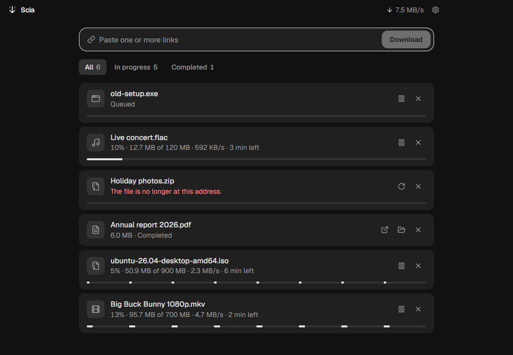

# Scia

A download manager for Windows: paste a link, and Scia fetches it over several connections, resumes it if it breaks, and asks nothing else of you.

[](https://github.com/m-bonanno/scia/releases)
[](https://github.com/m-bonanno/scia/actions/workflows/release.yml)
[](LICENSE)
[](https://github.com/sponsors/m-bonanno)

<picture>
  <source media="(prefers-color-scheme: light)" srcset="docs/design/downloads-in-progress-light.png">
  
</picture>

## What it does

- ⚡ **Several connections at once** for any http or https link, handing work over when one finishes early; a large file starts at once.
- ⏯️ **Pause and resume** from the bytes already on disk, also after Scia was closed and opened again.
- 🚦 **A queue with limits**: downloads at once, connections per download, the folder, and one speed limit for them all.
- 🗂️ **The system tray**: close the window and the downloads go on; with nothing left to download, closing quits.
- 🔔 **Notifications** when a download completes or fails, while Scia is not the window you are using.
- 🎨 **Nine colour themes**, each with a light and a dark variant that follows the system.
- 🔄 **Updates itself** from this repository's releases, fetched only while nothing else downloads; installed when you quit, or at "Restart now".
- 📋 **Links from the clipboard**, if you turn it on: what you copy waits as "Ready", a video's page named by its title, until you start it.
- 🎬 **The video a page plays**, on a site yt-dlp has a reader for: one file, an HLS stream, or picture and sound joined into one mp4, with no ffmpeg.
- 🔓 **AllDebrid**, connected by a code or your key: file hosts' links and folders, magnets pasted or copied, and your account's magnets.
- 🖼️ **Bunkr albums**: every file of a public album into a folder named after it, each file a resumable download.
- 🛡️ **Downloads marked as from the network**, as a browser marks them, and a downloaded program asks for a second press before it runs.
- 💜 **"Support Scia"** in Settings, which opens its Ko-fi page in your browser.
- 🧩 **A browser extension** that hands links and a page's media to Scia: written and tested, not yet tried in a real browser, nor published.

All of it is built and held by tests; much of it is still to be seen by a person in the installed app before the first stable release, and none of it has been tried on Linux. What was seen of each feature, and how: [`docs/product/evidence.md`](docs/product/evidence.md). What is left and what comes next: [`docs/product/roadmap.md`](docs/product/roadmap.md).

## Get it

**There is no stable release yet.** Scia is in pre-release: the latest `v1.0.0-beta.N` on the [Releases page](https://github.com/m-bonanno/scia/releases) carries its notes and a Windows installer, `Scia-Setup-<version>.exe`.

> [!WARNING]
> The installer is not signed, so Windows warns before running it. Download it only from this repository's Releases page, and run it only if you trust it.

- **Windows only, for now.** Linux is to follow: until after the first stable release it is untried, and no package of it is built.
- **Updates.** Scia takes the stable releases by itself. To keep taking the pre-releases too, turn on "Beta versions" in Settings (off by default): until the first stable release, there is nothing else to take.
- **Going back.** An installer older than the Scia installed refuses to run over it. Uninstall Scia first: your downloads and settings stay.

### Build from source

Node 24 or later.

```bash
npm ci          # install, and wire the git hooks
npm start       # build everything, then start the app on a scratch profile
npm run dist    # build the installer for this system
```

`npm run dev` serves the engine and the interface to a browser tab instead, on http://localhost:5173. How the project is built and how to work on it: [`CLAUDE.md`](CLAUDE.md). The architecture decisions: [`docs/adr/`](docs/adr/).

## Integrations

Beyond the hosts of the links you give it, Scia reaches only these: AllDebrid, once you connect it in Settings, its key kept where the system protects it — and, with no service connected, for AllDebrid's public list of file hosts, with no key and nothing of your links; yt-dlp, shipped with Scia, which reads a video's page on its site, and whatever that site's reader asks in turn; Bunkr — its pages, its API and the file servers it names — through a reader of Scia's own; and GitHub, for Scia's updates and yt-dlp's. Each one — what it adds, what it is sent, and how far it was seen — is recorded in [`docs/product/integrations.md`](docs/product/integrations.md). Scia collects nothing.

## Support

Scia is free. If it is useful to you, you can support it through [GitHub Sponsors](https://github.com/sponsors/m-bonanno) or on [Ko-fi](https://ko-fi.com/notsosnake), which takes one-off gifts by PayPal or card. "Support Scia" in Settings opens the Ko-fi page in your browser; Scia itself sends nothing.

## Contributing

Every change starts as an issue — a bug or a proposal, opened with a form — and the team opens the pull request that closes it: [`CONTRIBUTING.md`](CONTRIBUTING.md) says how, and what happens to your issue. How the team works: [`git-flow.md`](docs/development/git-flow.md), [`review-flow.md`](docs/development/review-flow.md), [`release-flow.md`](docs/development/release-flow.md).

## Licence

[MIT](LICENSE). The installer also carries yt-dlp's own build, unchanged, under its licence: [`apps/desktop/third-party/yt-dlp`](apps/desktop/third-party/yt-dlp/README.txt); and the engine bundles mux.js, under the Apache License 2.0: [`apps/desktop/third-party/mux.js`](apps/desktop/third-party/mux.js/README.txt).
