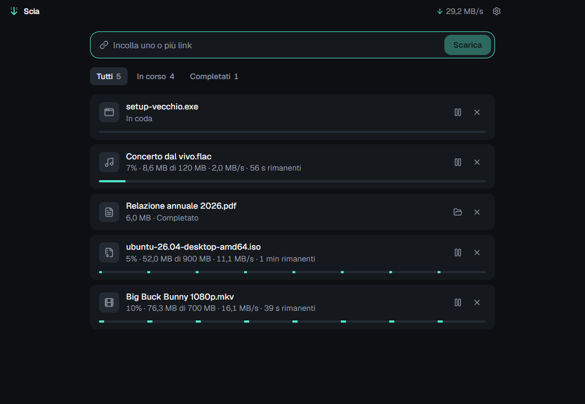

# Scia

Un gestore di download per Windows e Linux: incolli un link, Scia lo scarica su più connessioni, lo riprende se si interrompe, e non ti chiede altro.



## Cosa fa oggi

- Scarica qualsiasi link http/https su più connessioni in parallelo, ridistribuendo il lavoro quando una finisce prima delle altre.
- Mette in pausa e riprende dai byte già scaricati, anche dopo aver chiuso e riaperto l'app.
- Gestisce una coda: quanti download insieme e quante connessioni per download si scelgono nelle impostazioni.
- Riceve link e media dal browser tramite l'estensione (`apps/extension`).

Cosa arriva dopo: [`docs/product/roadmap.md`](docs/product/roadmap.md).

## Sviluppo

Serve Node 24 o successivo.

```bash
npm ci
npm run dev     # motore + interfaccia su http://localhost:5173
npm start       # l'app Electron vera, su un profilo di prova
npm test
```

Come è fatto il progetto e come ci si lavora: [`CLAUDE.md`](CLAUDE.md). Le decisioni di architettura: [`docs/adr/`](docs/adr/).

### Primo commit

Gli hook rifiutano i commit su `main` e `develop`. Il primo, che crea il repository, si fa una volta sola così:

```bash
git add -A
HUSKY=0 git commit -m "chore: bootstrap the monorepo"
git branch develop
```

Da lì in poi si lavora su `<tipo>/<issue>-<descrizione>` come descritto in [`docs/development/git-flow.md`](docs/development/git-flow.md).
